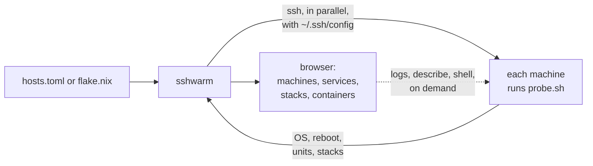

<p align="center">
  
</p>

<h1 align="center">sshwarm</h1>

<p align="center"><b><a href="https://k9scli.io">k9s</a> for ssh.</b> Your Linux machines, their services, containers and logs, in one terminal.</p>

<p align="center"><a href="https://asciinema.org/a/jHeN9sWGwwmMRVq2" target="_blank"></a></p>

Tired of ssh-ing into box after box to find out what's deployed where, which service died
overnight and which container is crash-looping? **sshwarm** shows the whole swarm at a
glance, with the logs of whatever is red a keypress away.

- **Every machine, one table:** uptime, pending reboot, systemd units, compose stacks.
- **Agentless:** a small bash probe over your own `ssh`, with your keys, agent and `~/.ssh/config`. Nothing to install on the machines.
- **Scriptable:** `sshwarm status` prints the table and exits 1 when anything is wrong.

## Get it

```sh
go install github.com/cmdoret/sshwarm@latest
```

Or run directly from the flake using nix:
```sh
nix run github:cmdoret/sshwarm -- --hosts hosts.toml
```

Or download a binary from the [releases](https://github.com/cmdoret/sshwarm/releases).

## Requirements

Linux machines with systemd and bash, reachable over ssh without a password prompt
(keys or agent), where the ssh user:

- is in the `systemd-journal` group.
- can run docker without password (either rootless or with passwordless sudo).

## Use

```sh
sshwarm --hosts hosts.toml
```

### Hosts file

Only `name` is required. ssh looks up `host`, or else `name`, in `~/.ssh/config` for
anything not set in the file, like ports or jump hosts. Set `SSHWARM_HOSTS` or
`SSHWARM_FLAKE` to skip the flag. See `sshwarm help` for more.

```toml
# hosts.toml: one [[host]] per machine
[[host]]
name = "db"                  # ssh db: user, key, port... from "Host db" in ~/.ssh/config

[[host]]
name = "web-1"
host = "web-1.example.org"   # ssh -i ~/.ssh/web deploy@web-1.example.org
user = "deploy"
key  = "~/.ssh/web"
```

### Nix flake

Instead of a hosts file, you may provide a Nix flake exposing `deploy.nodes` in its outputs.
See [deploy-rs](https://github.com/serokell/deploy-rs#overall-usage) for more information.

```sh
sshwarm --flake ./nix
```

## How it works



## Docker images

Container images are also available, but they suffer from a few usability limitations:

* nix is not included in the image, so you can only use `hosts.toml`
* `hosts.toml` must fully define the hosts, as ssh refuses a mounted `~/..ssh/config`.

```sh
docker run --rm -it -v ./hosts.toml:/hosts.toml:ro \
  -v ~/.ssh/id_ed25519:/root/.ssh/id_ed25519:ro -v ~/.ssh/known_hosts:/root/.ssh/known_hosts:ro \
  ghcr.io/cmdoret/sshwarm --hosts /hosts.toml
```

