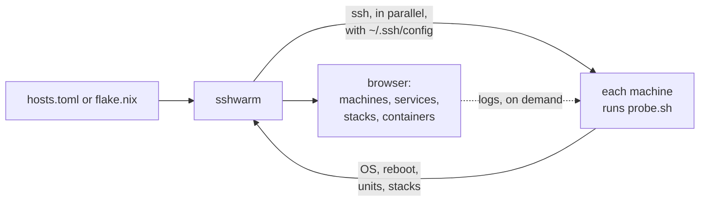

<p align="center">
  
</p>

<h1 align="center">sshwarm</h1>

<p align="center"><b><a href="https://k9scli.io">k9s</a> for ssh.</b> Your Linux machines, their services, containers and logs, in one terminal.</p>

<p align="center"></p>

Tired of ssh-ing into box after box to find out what's deployed where, which service died
overnight and which container is crash-looping? **sshwarm** shows the whole swarm at a
glance, with the logs of whatever is red a keypress away.

- **Every machine, one table:** uptime, pending reboot, systemd units, compose stacks.
- **Agentless and read-only:** a small bash probe over your own `ssh`, with your keys, agent and `~/.ssh/config`. Nothing to install on the machines.
- **Scriptable:** `sshwarm status` prints the table and exits 1 when anything is wrong.

## Get it

```sh
go install github.com/cmdoret/sshwarm@latest
```

Or run directly from the flake using nix:
```sh
nix run github:cmdoret/sshwarm -- --hosts hosts.toml
```

## Requirements

- `ssh`, and the machines listed in a TOML hosts file, or in a flake's `deploy.nodes`
  as for [deploy-rs](https://github.com/serokell/deploy-rs) (then also `nix`).
- Linux machines with systemd and bash, reachable over ssh without a password prompt
  (keys or agent), with:
    - ssh user in the `systemd-journal` group.
    - passwordless `sudo docker`.

## Use

```sh
sshwarm --hosts hosts.toml         # browse: machines, services, stacks, containers, logs; :ctr web-1 jumps
sshwarm --flake ./nix status web   # the table, for the machines whose name contains "web"
```

```toml
# hosts.toml: one [[host]] per machine
[[host]]
name = "db"                  # ssh db: user, key, port... from "Host db" in ~/.ssh/config

[[host]]
name = "web-1"
host = "web-1.example.org"   # ssh -i ~/.ssh/web deploy@web-1.example.org
user = "deploy"
key  = "~/.ssh/web"
```

Only `name` is required. ssh looks up `host`, or else `name`, in `~/.ssh/config` for
anything not set in the file, like ports or jump hosts. Set `SSHWARM_HOSTS` or
`SSHWARM_FLAKE` to skip the flag. The rest: `sshwarm help`.

## How it works


