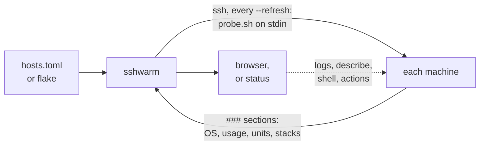
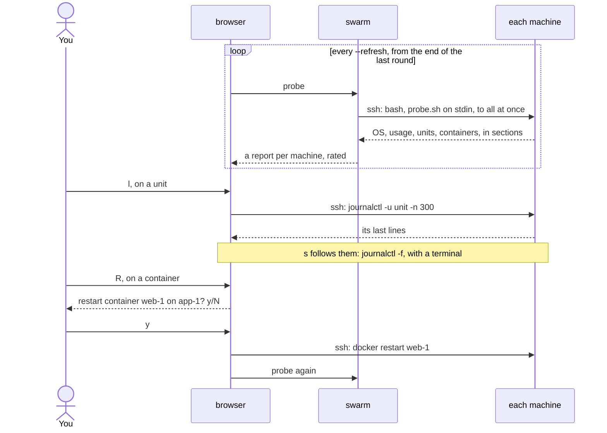

# Architecture

1. sshwarm reads the machines from a hosts file or a flake.
2. It pipes [`probe.sh`](https://github.com/cmdoret/sshwarm/blob/main/internal/swarm/probe.sh)
   to every machine over ssh, in parallel on every refresh.
3. The probe reads: OS, uptime, usage, pending reboot, `systemctl show` of every
   service, `docker ps` and `docker inspect` of compose containers. It prints
   outputs and failures.
4. sshwarm parses each machine's output into a report, and rates what's in it: idle,
   fine, warning or broken.
5. Logs, descriptions, shells and actions each run their own ssh command, on demand.

## Probing process

Example: A refresh, a unit's logs, then a container's restart:

## Code

The code is split into a few packages:

| | |
|---|---|
| `main.go` | flags, commands |
| `internal/inventory` | hosts file, flake |
| `internal/remote` | ssh: to the end, as a stream, or with the terminal; shared connections |
| `internal/swarm` | the probe and its parsing, the report, the commands for logs, descriptions and actions |
| `internal/ui` | the browser: screens, tables, cards, keys; `status`'s table and JSON |

## Choices

- **Agentless.** A bash script over the user's own ssh: nothing to install, and
  their ssh config, keys and agent just work.
- **The machine's clock.** Ages are computed with each machine's time.
- **Bounded waits.** The probe stops itself on the machine before sshwarm gives up
  on it (i.e. `--timeout`), and gives `df` 2 s, as a hung mount would hang it.
